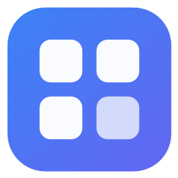
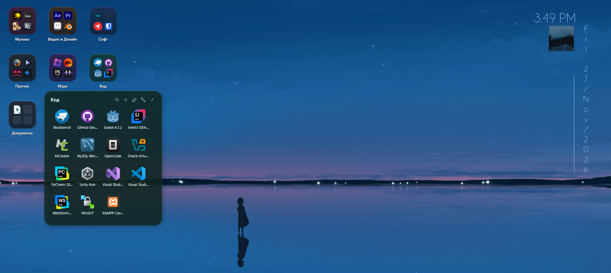
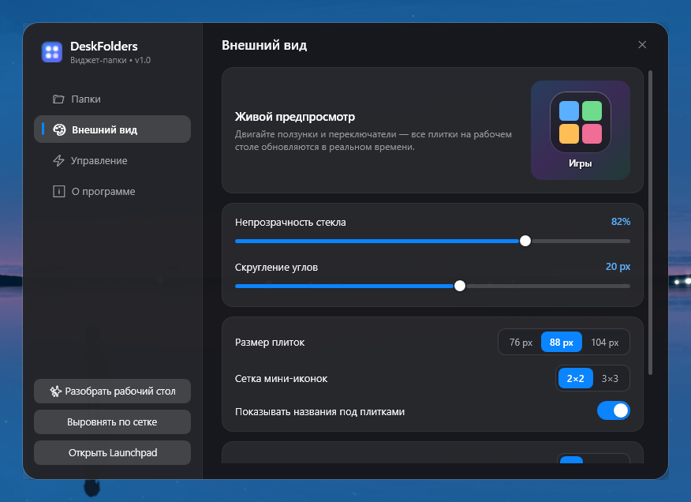

<div align="center">
  
  <h1>DeskFolders</h1>
  <p><b>Лёгкие виджет-папки для рабочего стола Windows 10/11 в стиле iOS / Android</b></p>

  <p>
    
    
    
  </p>

  <p>
    <a href="https://github.com/FindingSelfInDespair/DeskFolders/releases/latest">
      ⬇️ Скачать DeskFolders.exe (Последняя версия)
    </a>
  </p>

  <!-- Скриншоты: закинь screen1.png и screen2.png в папку docs/ или вставь через Ctrl+V в редакторе GitHub -->
  <p>
    <br/>
    
  </p>
</div>

---

### ✨ О программе

Стандартный рабочий стол Windows быстро превращается в свалку из десятков ярлыков игр, программ и случайных файлов, а громоздкие док-панели или тяжёлые лаунчеры нагружают систему.

**DeskFolders** группирует всё в компактные полупрозрачные папки прямо на рабочем столе (как на телефоне), потребляя **0% CPU в простое** и пару десятков мегабайт ОЗУ.

### 🧩 Основные возможности

* **Стеклянные папки на рабочем столе:** превью 2×2 или 3×3 из чётких HD-иконок, настройка размера (76 / 88 / 104 px), прозрачности, скругления углов, любой #HEX-цвет или собственная обложка.
* **Нативная интеграция с Windows 10/11:** плитки не отображаются в панели задач и Alt+Tab, не сворачиваются по Win+D и кнопке «Свернуть все окна», автоматически восстанавливаются после перезапуска explorer.exe или смены мониторов.
* **Умная сетка и порядок:** адаптивная сетка по всему экрану с превью-контуром и плавным доводчиком (или магнитным выравниванием и блокировкой позиций).
* **Удобное окно папки:** 4–6 колонок, плавный скролл или страницы точками, 3 режима подписей под иконками, переименование по клику на заголовок, навигация по подпапкам (‹ Назад) и закрепление окна (📌).
* **Живой Drag & Drop:** смена порядка иконок перетаскиванием внутри папки, перенос обратно на рабочий стол или в другую плитку, удаление в Корзину.
* **Тактильные микро-звуки:** лёгкие программные отклики при взаимодействии без внешних аудиофайлов (отключаются в настройках).

### 🚀 Launchpad и умный разбор рабочего стола

* **Режим Launchpad (Alt + ~):** вызывает все папки поверх любых окон со встроенным Spotlight-поиском по приложениям и названиям папок.
* **Умный авто-разбор:** анализирует ярлыки (.lnk, протоколы steam://, метаданные .exe и расширения файлов), сам создаёт папки (Игры, Код, Музыка, Видео и Дизайн, Софт, Документы, Прочее) и раскладывает мусор с рабочего стола за 1 клик.

### ⌨️ Горячие клавиши и управление

* Alt + ~ *(настраивается)* — открыть/закрыть **Launchpad** и поиск.
* ↑ ↓ ← → и Enter — навигация по иконкам и запуск с клавиатуры.
* Ctrl + Клик — запустить программу без закрытия папки.
* Средний клик по плитке — быстро открыть папку в Проводнике.
* Зажатие иконки (0.3 сек) — перестановка порядка, удаление в корзину или перенос на рабочий стол.

### 📥 Установка и запуск

1. Скачайте готовый **DeskFolders.exe** со страницы [Releases](https://github.com/FindingSelfInDespair/DeskFolders/releases/latest).
2. Запустите файл — программа появится в системном трее и предложит сразу разобрать рабочий стол или добавить свои папки.
3. Все настройки и координаты хранятся локально в config.json рядом с программой.

### 🛠️ Сборка из исходников

Требуется [.NET 8 SDK](https://dotnet.microsoft.com/download/dotnet/8.0).

```powershell
# Запуск в режиме разработки
dotnet run

# Сборка одного автономного .exe
.\publish.ps1 -SelfContained
```